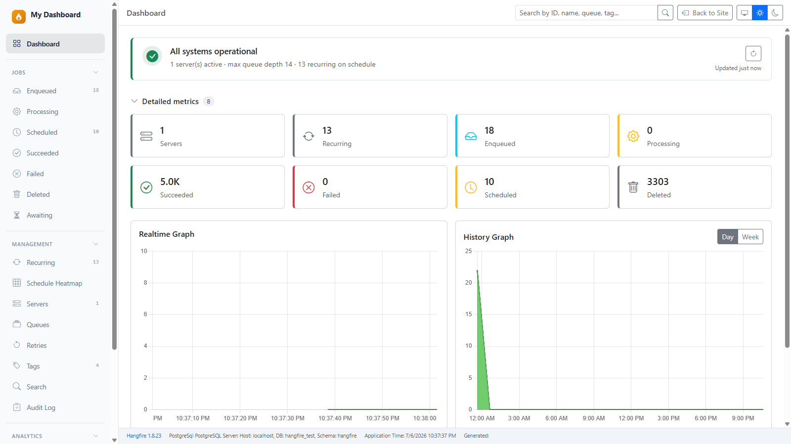
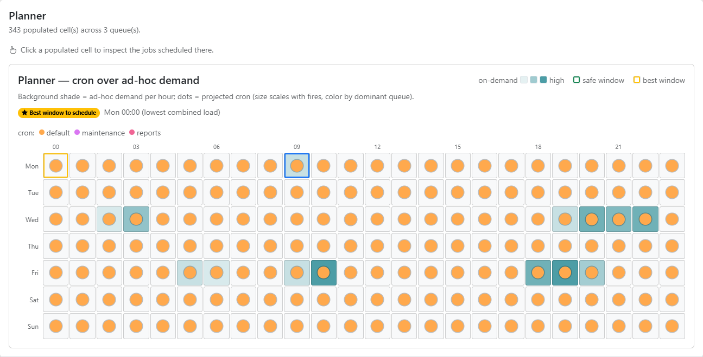
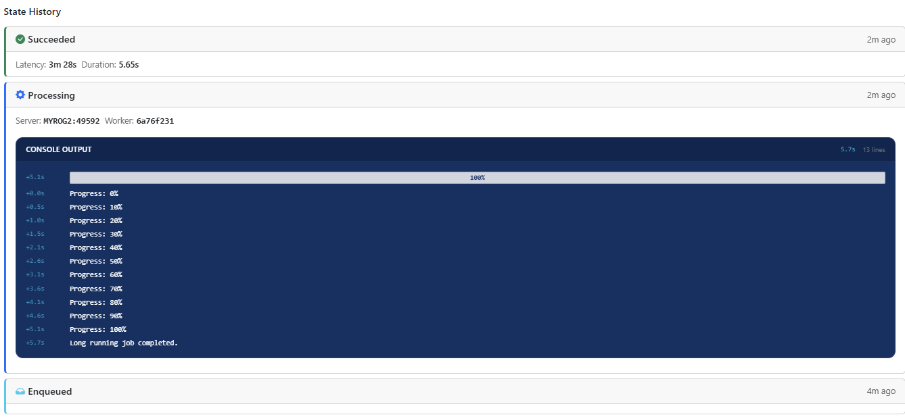
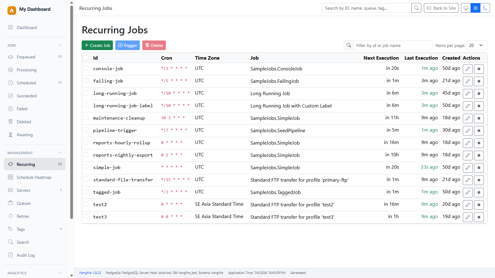

# a2n.Hangfire.Dashboard

**A modern, open-source dashboard extension for [Hangfire](https://www.hangfire.io/)** — analytics, console logs, tags, and recurring job management built in.

Open source (LGPL-3.0-or-later). Requires Hangfire 1.8+ and ASP.NET Core (.NET 8, 9, or 10). Not officially supported by Hangfire OÜ.

[](https://www.nuget.org/packages/a2n.Hangfire.Dashboard)
[](https://dotnet.microsoft.com/)
[](https://github.com/anwarminarso/a2n.Hangfire.Dashboard/blob/main/LICENSE)
[](https://www.hangfire.io/)

---



## Get Started in 30 Seconds

```bash
dotnet add package a2n.Hangfire.Dashboard
```

```csharp
// Use in place of app.UseHangfireDashboard():
builder.Services.AddHangfireDashboardUI();
app.UseHangfireDashboardUI("/hangfire");
```

Navigate to `/hangfire`. Done.

> **Authorization:** By default, only **local requests** are allowed (same as the Hangfire dashboard). For remote access, add a filter that checks who the user is — see [Authorization](#authorization) and [`samples/SampleAppAuth`](https://github.com/anwarminarso/a2n.Hangfire.Dashboard/tree/main/samples/SampleAppAuth) for a cookie login example. An empty filter list does **not** open the dashboard: it falls back to local requests only.

---

## What's New

**2.6.1 (patch)**: the Job Details banner shows when the storage will actually remove a job ([#97](https://github.com/anwarminarso/a2n.Hangfire.Dashboard/issues/97)), and a recurring job that is stopped, started and stopped again stays in the Stopped Jobs list ([#98](https://github.com/anwarminarso/a2n.Hangfire.Dashboard/issues/98)).

**2.6.0**: per-user read-only (`IsReadOnlyFunc`) with a **Read-only** badge, safer authorization and health-endpoint defaults, slow-storage resilience ([#64](https://github.com/anwarminarso/a2n.Hangfire.Dashboard/issues/64)), an in-process realtime feed ([#61](https://github.com/anwarminarso/a2n.Hangfire.Dashboard/issues/61)) and failed jobs grouped by exception ([#53](https://github.com/anwarminarso/a2n.Hangfire.Dashboard/issues/53)).

> **2.6.0 fixes security issues, and some fixes change defaults.** Read [Upgrading](https://github.com/anwarminarso/a2n.Hangfire.Dashboard/blob/main/CHANGELOG.md#upgrading) before deploying. Every release is described in the [changelog](https://github.com/anwarminarso/a2n.Hangfire.Dashboard/blob/main/CHANGELOG.md).

---

## About

Hangfire ships a capable monitoring UI out of the box. Many teams extend it with community packages for additional dashboard features — for example [Hangfire.Console](https://github.com/pieceofsummer/Hangfire.Console), [Hangfire.Tags](https://github.com/face-it/Hangfire.Tags), and [Hangfire.RecurringJobAdmin](https://github.com/bamotav/Hangfire.RecurringJobAdmin). Dashboard analytics are also available in [Hangfire Pro](https://www.hangfire.io/pricing/).

**a2n.Hangfire.Dashboard** combines several of these capabilities in one extension: search, filters, analytics (with optional storage adapters), console viewer, tags, recurring job CRUD, SignalR realtime updates, and theme options — while using the same Hangfire job storage and APIs.

---

## Features

| Feature | Description |
|---------|-------------|
| Job monitoring | Job state pages, batch operations, servers, retries, retry summary, job arguments on lists and Job Details |
| Recurring jobs | Create, edit, start and stop recurring jobs from the UI, with a visual cron builder |
| Schedule Heatmap | Recurring-job density by queue × day × hour, with Planner, Punchcard, Calendar, Concurrency and Recommendations views. [Details](https://github.com/anwarminarso/a2n.Hangfire.Dashboard/blob/main/docs/features/heatmap.md) |
| Job Builder | Create and schedule jobs with typed arguments, and enqueue one-off jobs at `/jobs/enqueue`. [Details](https://github.com/anwarminarso/a2n.Hangfire.Dashboard/blob/main/docs/features/job-builder.md) |
| Console output | Logs, progress bars and colors (Hangfire.Console-compatible API) |
| Job tags | Tagging and tag cloud (Hangfire.Tags-compatible storage) |
| Throttling | Semaphores, mutexes and rate limits, shown when the host uses [Hangfire.Throttling](https://docs.hangfire.io/en/latest/background-processing/throttling.html) |
| Job dependency graph | Continuation pipeline on the Job Details page. [Details](https://github.com/anwarminarso/a2n.Hangfire.Dashboard/blob/main/docs/features/job-dependency-graph.md) |
| Stack trace links | File references in stack traces link to GitHub, GitLab, Azure DevOps, Bitbucket or a local IDE. [Details](https://github.com/anwarminarso/a2n.Hangfire.Dashboard/blob/main/docs/features/stack-trace-links.md) |
| Global search | Search by job ID, name, queue, tag, exception text or arguments (`args:value`), with advanced filters. [Large instances](https://github.com/anwarminarso/a2n.Hangfire.Dashboard/blob/main/docs/guides/search-on-large-instances.md) |
| Analytics | Throughput, latency, failures and queue health (needs a storage adapter, see [Packages](#packages)) |
| Health checks | `/healthz` liveness, readiness and full report, plus a hero card on Home. [Details](https://github.com/anwarminarso/a2n.Hangfire.Dashboard/blob/main/docs/features/health-checks.md) |
| Operations | Queue pause, maintenance mode, failure fingerprints and grouping, audit log. [Details](https://github.com/anwarminarso/a2n.Hangfire.Dashboard/blob/main/docs/features/operations.md) |
| Slow-storage resilience | Bounded concurrent storage reads and refresh loops that back off. [Details](https://github.com/anwarminarso/a2n.Hangfire.Dashboard/blob/main/docs/guides/polling-and-slow-storage.md) |
| Authorization | Local-only default, per-user read-only, async filters and `LoginPath` redirect. See [Authorization](#authorization) |
| Realtime, theming, layout | Live metrics via SignalR; dark, light or auto theme; responsive from phones to ultrawide monitors |

The [feature overview](https://github.com/anwarminarso/a2n.Hangfire.Dashboard/blob/main/docs/features/README.md) describes each feature in more detail.

---

## Screenshots

| Schedule Heatmap — Planner | Home & Realtime Charts |
|:---:|:---:|
|  |  |

| Console Viewer | Recurring Jobs |
|:---:|:---:|
|  |  |

More in the [screenshot gallery](https://github.com/anwarminarso/a2n.Hangfire.Dashboard/blob/main/docs/screenshots.md) and the [heatmap page](https://github.com/anwarminarso/a2n.Hangfire.Dashboard/blob/main/docs/features/heatmap.md).

---

## Packages

| NuGet package | Purpose |
|---------------|---------|
| [`a2n.Hangfire.Dashboard`](https://www.nuget.org/packages/a2n.Hangfire.Dashboard) | Main dashboard UI (search, console, tags, recurring admin) |
| [`a2n.Hangfire.Dashboard.SqlServer`](https://www.nuget.org/packages/a2n.Hangfire.Dashboard.SqlServer) | Storage-specific queries + full analytics for SQL Server |
| [`a2n.Hangfire.Dashboard.PostgreSql`](https://www.nuget.org/packages/a2n.Hangfire.Dashboard.PostgreSql) | Storage-specific queries + full analytics for PostgreSQL |
| [`a2n.Hangfire.Dashboard.Rollup`](https://www.nuget.org/packages/a2n.Hangfire.Dashboard.Rollup) | Rollup-based analytics for non-SQL storages (Redis, in-memory, other NoSQL) |
| [`a2n.Hangfire.Dashboard.Redis`](https://www.nuget.org/packages/a2n.Hangfire.Dashboard.Redis) | Convenience entry point for Redis — registers rollup metrics (`UseRedisStorage()`) |
| [`a2n.Hangfire.Console`](https://www.nuget.org/packages/a2n.Hangfire.Console) | Console integration (Hangfire.Console-compatible API) |
| [`a2n.Hangfire.Tags`](https://www.nuget.org/packages/a2n.Hangfire.Tags) | Tags integration (Hangfire.Tags-compatible storage) |

Without a storage adapter package, search and core dashboard features work; the **Analytics** pages and heatmap **Historical** source require a metrics adapter:

- **SQL Server / PostgreSQL** — `UseSqlServerStorage()` / `UsePostgreSqlStorage()` (direct SQL queries; best accuracy)
- **Redis / in-memory / other non-SQL** — `UseRedisStorage()` or `UseRollupMetrics()` (incremental rollup; forward-only historical data)

```csharp
// Redis (Hangfire Pro or community StackExchange.Redis storage already configured)
builder.Services.AddHangfireDashboardUI(options => options.UseRedisStorage());

// Any other non-SQL Hangfire storage
builder.Services.AddHangfireDashboardUI(options => options.UseRollupMetrics());
```

The adapter's connection string is only used by its own queries (search, Analytics, the heatmap's Historical source); everything else goes through Hangfire's `JobStorage`. See [Which connection each read uses](https://github.com/anwarminarso/a2n.Hangfire.Dashboard/blob/main/docs/guides/polling-and-slow-storage.md#which-connection-each-read-uses) for how to keep the dashboard's load low.

---

## Full Setup

```csharp
using a2n.Hangfire.Dashboard;
using Hangfire;
using Hangfire.Console;  // Hangfire.Console-compatible API (bundled in this package)
using Hangfire.Tags;     // Hangfire.Tags-compatible API (bundled in this package)

var builder = WebApplication.CreateBuilder(args);

var connectionString = builder.Configuration.GetConnectionString("Hangfire")
    ?? throw new InvalidOperationException("Connection string 'Hangfire' not found.");

builder.Services.AddHangfire(config => config
    .UseSqlServerStorage(connectionString)  // or .UsePostgreSqlStorage(connectionString)
    .UseConsole()        // Enable console output
    .UseTags());         // Enable job tagging

builder.Services.AddHangfireServer();

// Basic setup (search works; analytics requires a storage adapter — see Packages)
builder.Services.AddHangfireDashboardUI();

// With storage adapter for storage-specific queries + full analytics:
// builder.Services.AddHangfireDashboardUI(options =>
// {
//     options.UseSqlServerStorage(connectionString);
//     // options.UsePostgreSqlStorage(connectionString);
// });

var app = builder.Build();

app.UseHangfireDashboardUI("/hangfire", new DashboardUIOptions
{
    DashboardTitle = "My Jobs",
    DefaultTheme = "auto",  // "auto", "light", or "dark"
    EnableJobManagement = true,  // set false to hide Create/Edit/Stop and the Enqueue page
    IsReadOnly = false,  // true = view-only: every requeue/delete/enqueue/trigger/stop/start/edit/pause action is hidden and refused by the services
    JobGraphMaxDepth = 5,   // continuation graph traversal depth (default 5)
    JobGraphMaxNodes = 30,  // continuation graph node budget (default 30)
    SearchTimeoutSeconds = 30,  // Search page limit; 0 = no limit, storage command timeout applies (default 30)
    StatsPollingInterval = 2000,  // realtime metrics cadence in ms, one storage read shared by all tabs (default 2000, min 500)
    EnablePrerendering = true,  // false = skip the server prerender pass (default true)
    // Heatmap = new HeatmapOptions { DemandRollupEnabled = false },  // stop the 60 s ad-hoc demand poll
    // Polling = new PollingOptions { MaxConcurrentStorageCalls = 8 },  // storage call limit and refresh intervals, see "Polling and Slow Storage"
    // SourceLink = SourceLinkOptions.GitHub("owner/repo"),  // clickable stack-trace file links
});

app.Run();
```

If the dashboard renders but nothing reacts to clicks, see [The Blazor script](https://github.com/anwarminarso/a2n.Hangfire.Dashboard/blob/main/docs/guides/blazor-script.md) (most often a .NET 10 Web API or SPA host).

---

## Authorization

By default only local requests are allowed (`LocalRequestsOnlyAuthorizationFilter`, the same rule as Hangfire's dashboard). For remote access, add filters that check who the user is. Every filter in `Authorization` and `AsyncAuthorization` must pass, and they cover the pages, the Blazor circuit and the SignalR hub:

```csharp
public sealed class HangfireAdminFilter : IDashboardAuthorizationFilter
{
    public bool Authorize(HttpContext context)
        => context.User.Identity?.IsAuthenticated == true && context.User.IsInRole("HangfireAdmin");
}

app.UseAuthentication();
app.UseHangfireDashboardUI("/hangfire", new DashboardUIOptions
{
    Authorization = [new HangfireAdminFilter()],
    LoginPath = "/login",   // optional: redirect instead of 401
});
```

[`samples/SampleAppAuth`](https://github.com/anwarminarso/a2n.Hangfire.Dashboard/tree/main/samples/SampleAppAuth) is a complete cookie login example.

- **No filter at all means local only.** If `Authorization` and `AsyncAuthorization` are both empty or null, the dashboard accepts local requests only and logs a warning at startup. This is a change from 2.5.x, where an empty list let everyone in.
- **Opening the dashboard to everyone has to be explicit.** When access is enforced elsewhere (an authenticating reverse proxy, a private network), use `Authorization = [new AllowAllRequestsAuthorizationFilter()]`. The dashboard then logs a warning at startup and shows a banner on every page. The health endpoint in `RequireDashboardAuth` mode is open too, since it uses the same filters.
- **Read-only users.** `IsReadOnly = true` makes the dashboard view-only for everyone. With the `DashboardOptions` overload, `IsReadOnlyFunc` decides per user (see [Existing DashboardOptions](https://github.com/anwarminarso/a2n.Hangfire.Dashboard/blob/main/docs/guides/migrating-from-hangfire-dashboard.md#existing-dashboardoptions-still-works)). Either way, write actions are hidden, refused by the services, and the header shows a **Read-only** badge with the reason.
- **Permissions are evaluated when a page loads.** An open tab keeps the access it had when it was loaded: if a user's role is revoked, the change applies at their next page load, not in tabs they already have open.
- **Behind a reverse proxy on the same host,** every request arrives from `127.0.0.1`, so the local-only default lets **every** client in. Call `app.UseForwardedHeaders()` before `UseHangfireDashboardUI`, or better, use a filter that checks the user. See [Behind a reverse proxy](https://github.com/anwarminarso/a2n.Hangfire.Dashboard/blob/main/docs/guides/reverse-proxy.md).

---

## Using with existing Hangfire code

Job code written for `Hangfire.Console` and `Hangfire.Tags` compiles unchanged against the bundled packages, existing console logs and tags show up without migration, and `UseHangfireDashboardUI` also accepts your existing `DashboardOptions` (including `IsReadOnlyFunc`). See [Using with existing Hangfire code](https://github.com/anwarminarso/a2n.Hangfire.Dashboard/blob/main/docs/guides/migrating-from-hangfire-dashboard.md).

> **Don't reference `a2n.Hangfire.Console` together with the original `Hangfire.Console`** (or `a2n.Hangfire.Tags` with `Hangfire.Tags`). The bundled packages use the same namespaces, so both in one project give ambiguous type errors. Pick one per project.

---

## Documentation

- **Features:** [Overview](https://github.com/anwarminarso/a2n.Hangfire.Dashboard/blob/main/docs/features/README.md) · [Schedule Heatmap](https://github.com/anwarminarso/a2n.Hangfire.Dashboard/blob/main/docs/features/heatmap.md) · [Job Builder](https://github.com/anwarminarso/a2n.Hangfire.Dashboard/blob/main/docs/features/job-builder.md) · [Job Dependency Graph](https://github.com/anwarminarso/a2n.Hangfire.Dashboard/blob/main/docs/features/job-dependency-graph.md) · [Stack Trace Source Links](https://github.com/anwarminarso/a2n.Hangfire.Dashboard/blob/main/docs/features/stack-trace-links.md) · [Health Checks](https://github.com/anwarminarso/a2n.Hangfire.Dashboard/blob/main/docs/features/health-checks.md) · [Operations](https://github.com/anwarminarso/a2n.Hangfire.Dashboard/blob/main/docs/features/operations.md)
- **Guides:** [Using with existing Hangfire code](https://github.com/anwarminarso/a2n.Hangfire.Dashboard/blob/main/docs/guides/migrating-from-hangfire-dashboard.md) · [Polling and Slow Storage](https://github.com/anwarminarso/a2n.Hangfire.Dashboard/blob/main/docs/guides/polling-and-slow-storage.md) · [Search on Large Instances](https://github.com/anwarminarso/a2n.Hangfire.Dashboard/blob/main/docs/guides/search-on-large-instances.md) · [Behind a reverse proxy](https://github.com/anwarminarso/a2n.Hangfire.Dashboard/blob/main/docs/guides/reverse-proxy.md) · [The Blazor script](https://github.com/anwarminarso/a2n.Hangfire.Dashboard/blob/main/docs/guides/blazor-script.md)
- **Project:** [Changelog](https://github.com/anwarminarso/a2n.Hangfire.Dashboard/blob/main/CHANGELOG.md) · [Roadmap](https://github.com/anwarminarso/a2n.Hangfire.Dashboard/blob/main/docs/ROADMAP.md) · [Development](https://github.com/anwarminarso/a2n.Hangfire.Dashboard/blob/main/docs/development.md) (tech stack, project structure, samples) · [Contributing](https://github.com/anwarminarso/a2n.Hangfire.Dashboard/blob/main/CONTRIBUTING.md)

---

## Running the Sample

```bash
git clone https://github.com/anwarminarso/a2n.Hangfire.Dashboard.git
cd a2n.Hangfire.Dashboard/samples/SampleApp
dotnet run
```

Open `https://localhost:7100/hangfire`. For a login page, run [`samples/SampleAppAuth`](https://github.com/anwarminarso/a2n.Hangfire.Dashboard/tree/main/samples/SampleAppAuth) instead. Next up: Prometheus `/metrics`, OpenTelemetry trace links and a read-only REST API in 2.7; see the [roadmap](https://github.com/anwarminarso/a2n.Hangfire.Dashboard/blob/main/docs/ROADMAP.md).

## Contributing

Contributions welcome: bug reports, feature requests, documentation improvements and pull requests. See [CONTRIBUTING.md](https://github.com/anwarminarso/a2n.Hangfire.Dashboard/blob/main/CONTRIBUTING.md) for the fork workflow, code style and pull request guidelines.

## License

LGPL-3.0-or-later — see [LICENSE](https://github.com/anwarminarso/a2n.Hangfire.Dashboard/blob/main/LICENSE).

## Acknowledgments

This project builds on the excellent work of the Hangfire community:

- [Hangfire](https://www.hangfire.io/) — the background job framework
- [Hangfire.Console](https://github.com/pieceofsummer/Hangfire.Console) — console output for background jobs
- [Hangfire.Tags](https://github.com/face-it/Hangfire.Tags) — job tagging
- [Hangfire.RecurringJobAdmin](https://github.com/bamotav/Hangfire.RecurringJobAdmin) — recurring job management UI
- [Hangfire.Community.Dashboard.Heatmap](https://github.com/brodrigz/Hangfire.Community.Dashboard.Heatmap) by Bruno Rodrigues (brodrigz) — design inspiration for the recurring schedule heatmap (independent Blazor implementation)

Community extensions are listed on the [Hangfire Extensions](https://www.hangfire.io/extensions.html) page. This project is community-maintained and is not officially supported by Hangfire OÜ.

---

<p align="center">
  <sub>Built with ☕ by <a href="https://github.com/anwarminarso">Anwar Minarso</a></sub>
</p>
