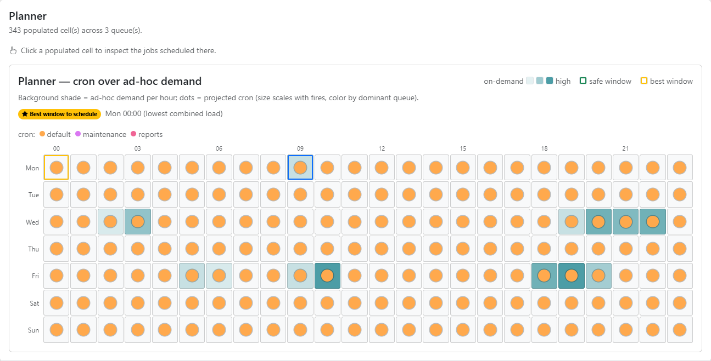
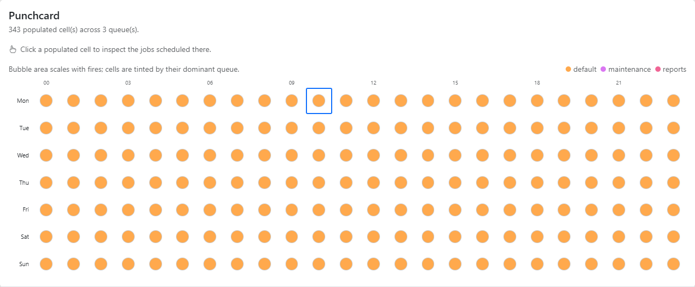
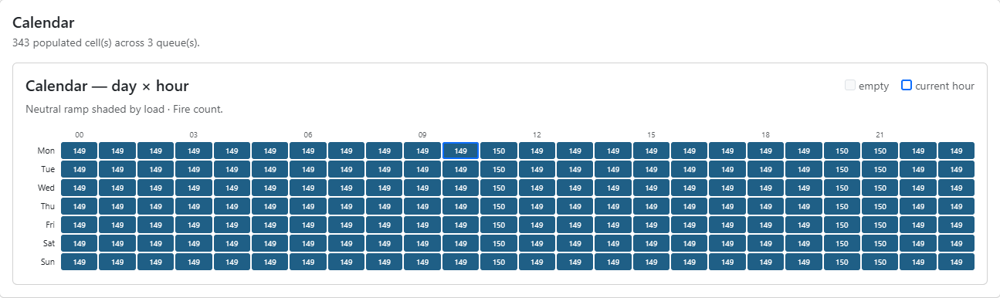
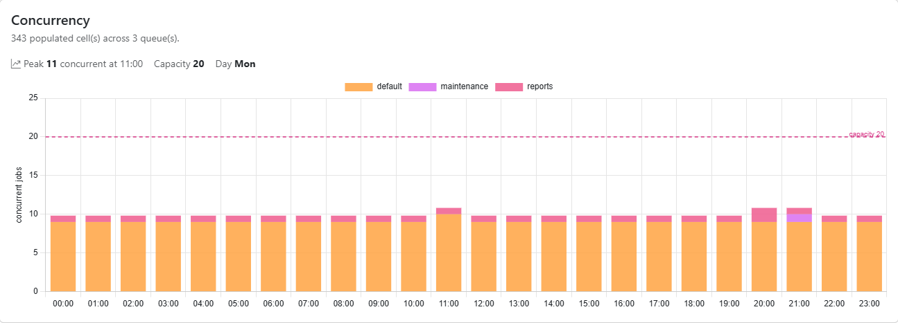
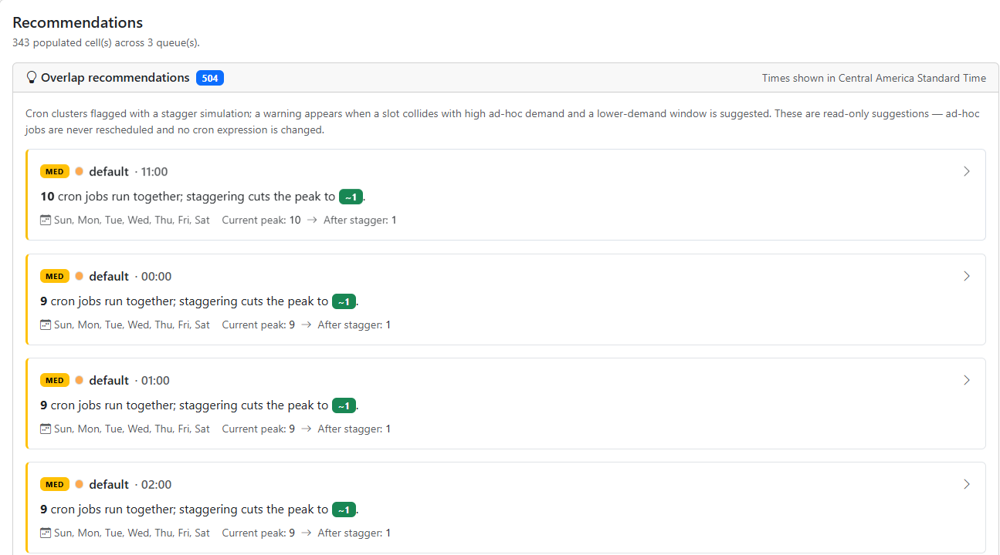
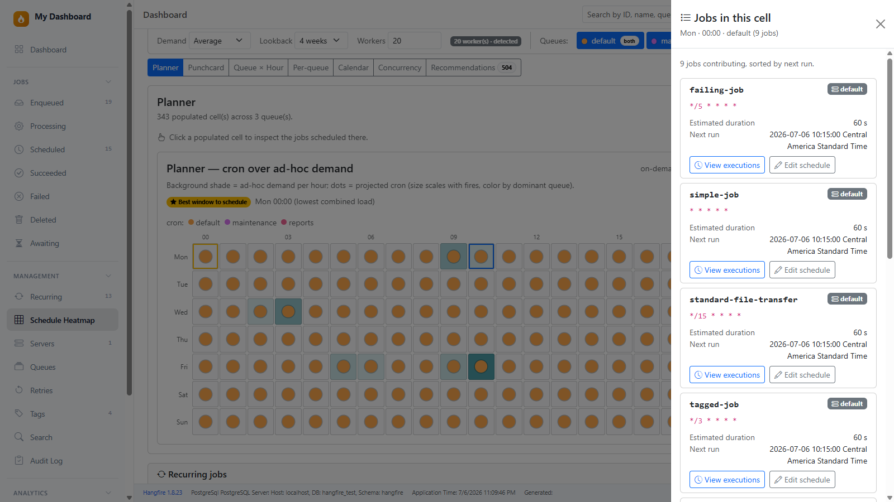

# Recurring Schedule Heatmap

Back to the [README](../../README.md).

Project your recurring (cron) jobs — and real ad-hoc demand — onto a **queue × day × hour** grid to spot collisions, find the quietest window to schedule, and rebalance load. Multiple views, click-through drill-down, and (with a storage adapter) a Historical/Demand source.

| Planner — cron over ad-hoc demand |
|:---:|
|  |

| Punchcard | Calendar |
|:---:|:---:|
|  |  |

| Concurrency | Overlap Recommendations |
|:---:|:---:|
|  |  |

| Cell drill-down — jobs scheduled in a slot |
|:---:|
|  |
