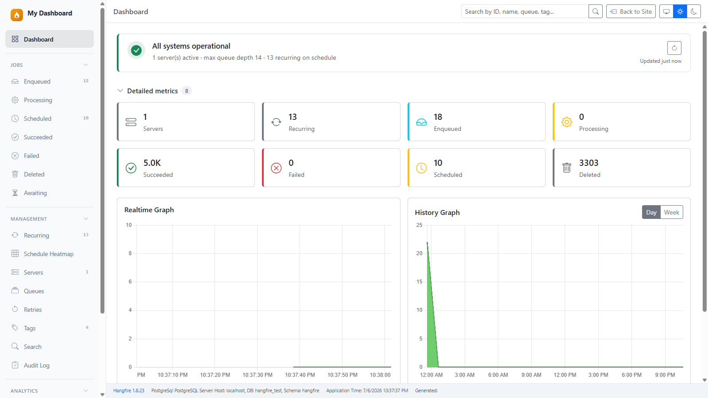
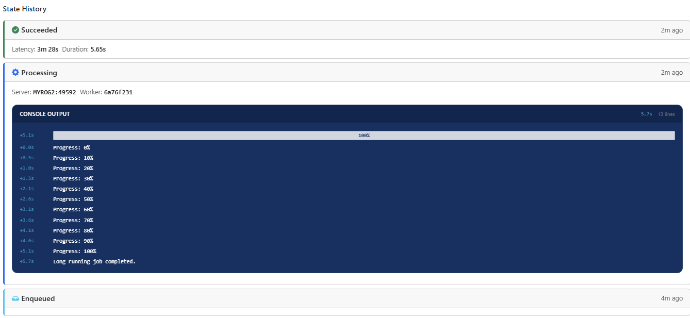
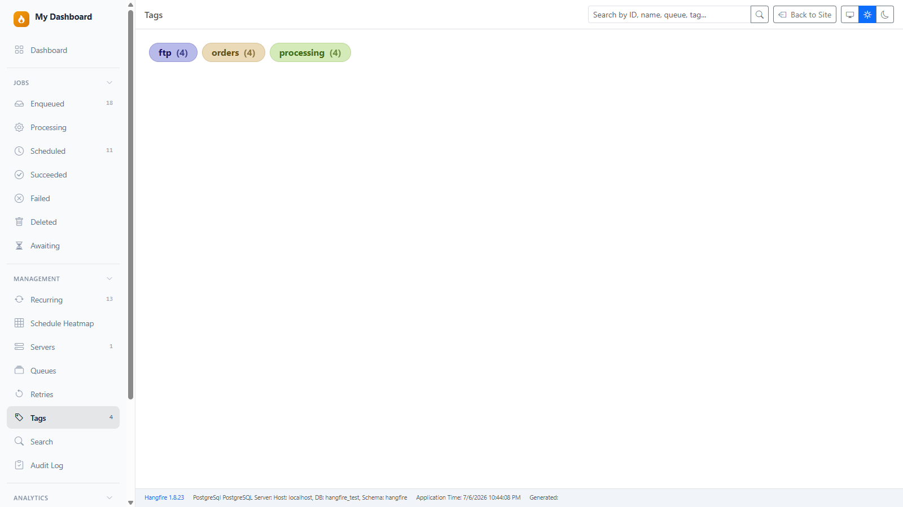
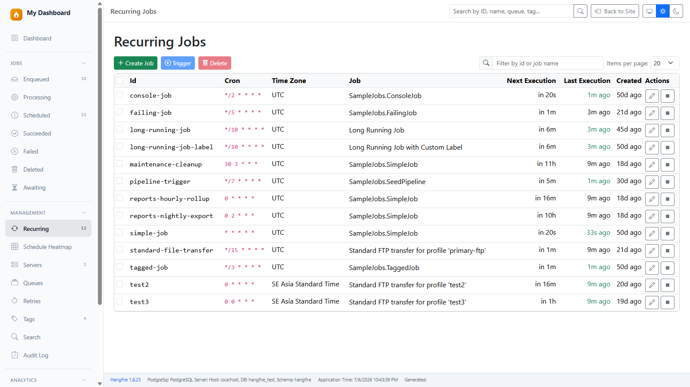
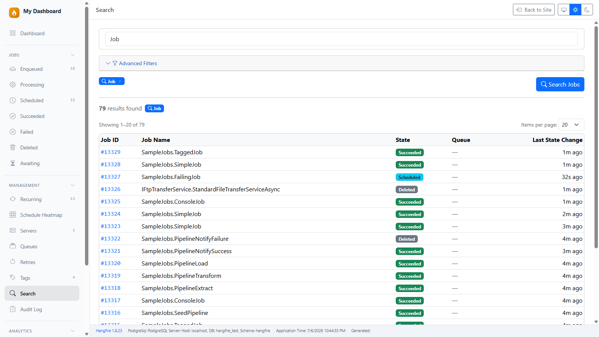
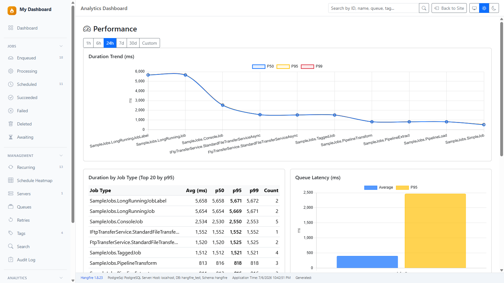
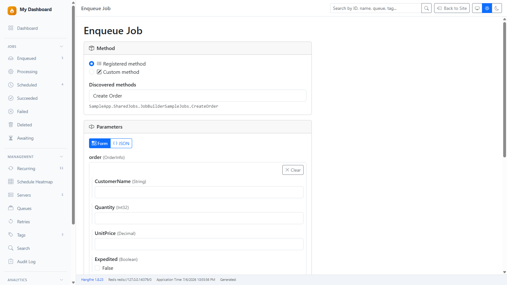
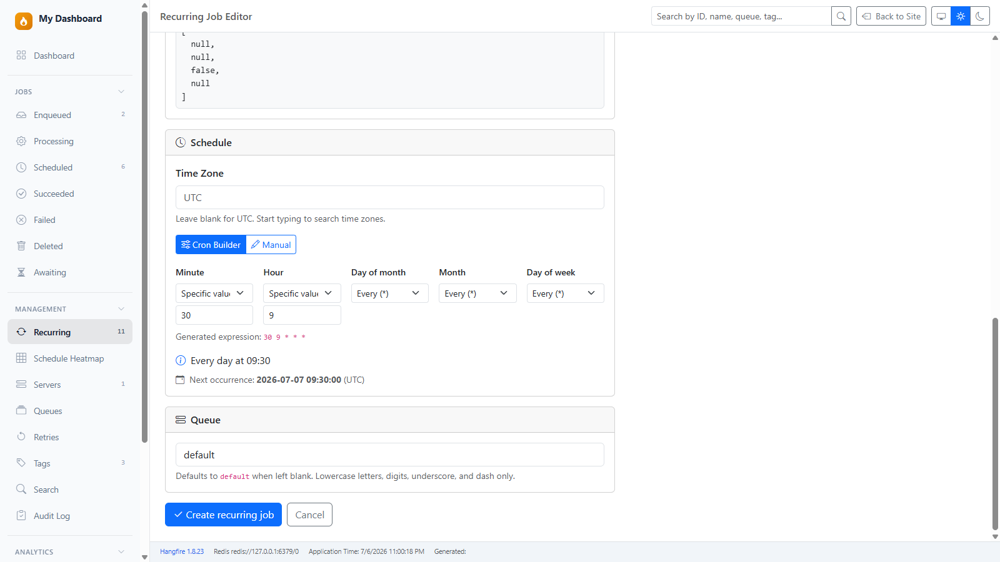
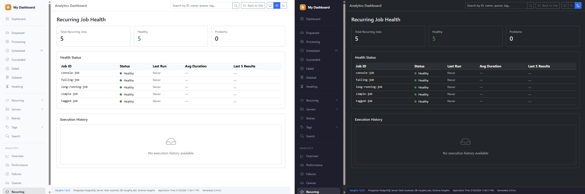

# Screenshots

Back to the [README](../README.md). The heatmap views have their own page: [Recurring Schedule Heatmap](features/heatmap.md).

| Home & Realtime Charts | Console Viewer |
|:---:|:---:|
|  |  |

| Tags & Search | Recurring Jobs |
|:---:|:---:|
|  |  |

| Advanced Search | Analytics |
|:---:|:---:|
|  |  |

| Enqueue Job (typed args) | Recurring Schedule (Cron Builder) |
|:---:|:---:|
|  |  |

| Light / Dark / Auto |
|:---:|
|  |
